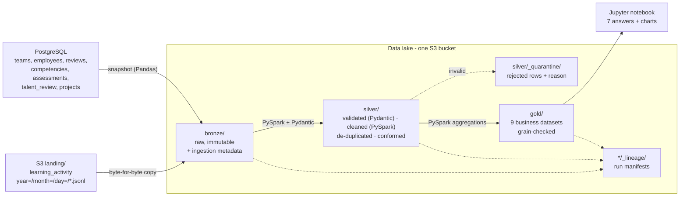

# ACME Inc. — Employee Performance Data Pipeline

A batch ETL pipeline that turns ACME's scattered performance, skills, talent and training data into
analytics-ready datasets that answer seven business questions. Built for the Citi Data Engineering Workshop
(data engineer track) on the official `coding-workshop-participant` repository.

| | |
|---|---|
| **Job** | `data/acme-performance/job.py` (one file: the workshop's Helm chart ships only `job.py` + `requirements.txt` to EKS) |
| **Stack** | Python 3.13, **PySpark 4.1.2**, **Pandas**, **Pydantic 2**, boto3, psycopg2, Jupyter |
| **Sources** | PostgreSQL (7 tables) + S3 landing zone (783 JSON-lines files, 29,868 learning events) |
| **Data lake** | One S3 bucket, medallion layout: `landing/` → `bronze/` → `silver/` → `gold/` |
| **Outputs** | 9 Gold datasets + insights notebook (`notebooks/acme_performance_insights.ipynb`) |
| **Tests** | 69 tests, 98 % coverage — see [TEST_EVIDENCE.md](TEST_EVIDENCE.md) |
| **Mapping** | Column-level source → target lineage — see [docs/SOURCE_TO_TARGET.md](docs/SOURCE_TO_TARGET.md) |

## Architecture



### Layers and storage paths

| Layer | Path | Format | Written by | Re-run behaviour |
|---|---|---|---|---|
| Landing | `landing/learning_activity/year=YYYY/month=MM/day=DD/*.jsonl` | JSONL (source drop) | source system / `aws s3 sync` | — |
| Bronze (tables) | `bronze/postgres/<table>/ingest_date=YYYY-MM-DD/<table>.parquet` | Parquet, source columns + `_ingest_run_id`, `_ingested_at`, `_source_system`, `_source_object` | `--stage bronze` | same-day snapshot overwritten → no duplicates; one snapshot per day kept as history |
| Bronze (events) | `bronze/learning_activity/year=/month=/day=/*.jsonl` | raw bytes (size-verified) + S3 object metadata | `--stage bronze` | incremental: files already in Bronze are skipped; never modified (immutable) |
| Silver | `silver/<entity>/` (events: `silver/learning_activity/event_year=/event_month=/`) | Parquet with explicit schema + `_silver_run_id`, `_bronze_run_id` / `_source_file` | `--stage silver` | prefix replaced per entity (delete, then upload) → identical output |
| Quarantine | `silver/_quarantine/<entity>/ingest_date=/rejected.jsonl` | JSONL: entity, reason, field errors, raw record, source file | `--stage silver` | overwritten per day |
| Gold | `gold/<table>/` | Parquet + `_gold_run_id` | `--stage gold` | prefix replaced → identical output |
| Lineage | `{bronze,silver,gold}/_lineage/ingest_date=/<stage>-<run_id>.json` | JSON manifest: status, source → target, counts, checks | every stage, also on failure | one per run (audit trail) |

Partitioning: events are partitioned by date in Bronze (as delivered) and by `event_year/event_month` in Silver
(37 monthly partitions) so time-bounded reads touch only the months they need. The other entities are small
(≤ 4,000 rows) and stored unpartitioned to avoid a small-files problem.

## The seven business questions → Gold datasets

| # | Question | Gold dataset (grain) | Key rule |
|---|---|---|---|
| 1 | Performance ratings & review history | `employee_performance_history` (employee × review period) | `rating_change` vs previous review |
| 2 | Critical skill gaps | `employee_skill_gaps` (employee × competency), `competency_coverage` (competency) | critical gap = required − proficiency ≥ 2 |
| 3 | High-potential, promotion-ready | `promotion_readiness` (employee) | High potential + Ready Now + latest rating ≥ 4 + no critical gaps |
| 4 | Training completed | `employee_training_summary` (employee), `employee_course_progress` (employee × course) | all employees included (zeros when no activity) |
| 5 | Attrition risk | `attrition_risk` (employee) | label points 1–3, +1 declining, +1 rating ≤ 2, +1 no learning in 12 months |
| 6 | Performance vs teams & projects | `team_performance` (team) | projects join on `team_id` (team level only) |
| 7 | Skill distribution | `skill_distribution` (department × competency) | counts per proficiency level 1–5 |

Thresholds are named constants at the top of the Gold section of `job.py` (`CRITICAL_GAP_LEVELS`, `LOW_RATING`,
`HIGH_RATING`, `RECENT_TRAINING_DAYS`).

## Data quality and validation

* **Schema contracts** — one Pydantic model per entity, derived from the dataset's `schema.sql`: types, `NOT NULL`,
  `CHECK` enums (category, outcome status, potential, readiness, risk), ranges (rating and levels 1–5, score 0–100,
  outcome score 0–100 with 2 decimals), patterns (`YYYY-H1/H2`, `EV##########`, e-mail), no future hire dates.
  The same models generate the explicit Spark schemas, so the contract is defined once.
* **Foreign keys** — employees → teams, projects → teams, reviews/assessments/talent → employees,
  assessments → competencies, events → employees. Orphans are quarantined with reason `unknown_<column>`.
* **Duplicates** — exact duplicate event lines are removed (same event delivered twice); primary-key duplicates are dropped.
* **Schema drift** — events that send `notes` instead of `text` are conformed; string employee ids are cast.
* **Nothing is silently lost** — every Silver entity must satisfy
  `rows_read = duplicates_removed + rows_rejected + rows_written`, otherwise the run fails.
* **Gold checks** — every table: grain unique, no null keys, row count equals the expected Silver count; learning
  events counted in Gold must equal Silver.

Results on the sample: all 12,173 table rows valid; events 29,868 read → 152 duplicates, 142 quarantined
(13 malformed JSON, 76 invalid/missing employee, 53 invalid date), 29,574 written.

## Observability and error handling

* Structured JSON logs (`INFO` / `WARNING` / `ERROR`) with run id, record counts per step, start/end, duration and
  exit status; `run_local.sh` also saves each run to `data/acme-performance/logs/`.
* Lineage manifests per stage and run — including failed runs (`status: FAILED`).
* PostgreSQL and S3 calls retry with exponential backoff (1 s, 2 s, 4 s); boto3 standard retries (5 attempts) on top.
* Malformed rows never stop the pipeline: they go to quarantine. Structural problems (missing settings, empty
  sources, failed reconciliation) stop it with a clear error and exit code 1.

## How to run (VDI)

Prerequisites: the workshop VDI set up with `bin/setup-environment.sh`, LocalStack running, and the sample data
loaded into the local PostgreSQL database `acme_performance` (dataset `load.sh`).

```bash
cd ~/coding-workshop-participant
cp data/acme-performance/.env.sample data/acme-performance/.env.local   # local settings (git-ignored)

# Landing zone in LocalStack (once)
export AWS_ACCESS_KEY_ID=test AWS_SECRET_ACCESS_KEY=test
aws --endpoint-url http://localhost:4566 s3 mb s3://coding-workshop-datalake-1bd9f4ac
aws --endpoint-url http://localhost:4566 s3 sync \
    sampleData/data-engineering-performance-talent-management/learning_activity \
    s3://coding-workshop-datalake-1bd9f4ac/landing/learning_activity/

./data/acme-performance/run_local.sh                 # all stages: bronze → silver → gold
./data/acme-performance/run_local.sh --stage silver  # or one stage
./data/acme-performance/run_tests.sh                 # 69 tests + coverage report
./notebooks/run_notebook.sh                          # execute the insights notebook
```

The first run creates `data/acme-performance/.venv` and installs `requirements.txt`. `run_local.sh` also repairs two
VDI quirks automatically: an invalid `JAVA_HOME` and a separately installed `SPARK_HOME`.

### Configuration (environment variables only)

| Variable | Local (VDI) | Cloud |
|---|---|---|
| `IS_LOCAL` | `true` | `false` (enables `sslmode=require`) |
| `POSTGRES_HOST` / `PORT` / `NAME` / `USER` / `PASS` | local PostgreSQL | Aurora endpoint and credentials |
| `DATA_LAKE_BUCKET` | `coding-workshop-datalake-1bd9f4ac` | same name (falls back to `coding-workshop-datalake-$APP_ID`) |
| `AWS_ENDPOINT_URL` | `http://localhost:4566` (LocalStack) | unset (real S3) |
| `AWS_REGION` | `us-east-1` (LocalStack) | `ap-south-1` |
| `SPARK_MASTER`, `LOG_LEVEL` | optional | optional |

No secret is stored in the repository; `.env.local` is git-ignored.

## Design decisions and trade-offs

| Decision | Why | Trade-off |
|---|---|---|
| Single `job.py` with clear sections | The workshop Helm chart ships only `job.py` + `requirements.txt` to EKS | One long file instead of modules; sections + pure helper functions keep it testable |
| Pandas for Bronze, PySpark for Silver/Gold | Bronze is a straight copy (no Spark start-up needed); transformations use Spark as required | Two engines; Spark is imported lazily so Bronze stays light |
| Spark reads/writes local temp files, boto3 moves them to/from S3 | Works identically on LocalStack and AWS with no Hadoop S3A jars or credentials plumbing | Not suitable for very large data; switch to `s3a://` paths if volumes grow |
| Raw event files copied byte-for-byte to Bronze | Immutable raw zone; file sizes provably match the source | Parsing happens in Silver, not Bronze |
| Daily Bronze snapshots of PostgreSQL | Simple, idempotent, keeps history | Full snapshot each day (fine at this size); CDC would scale better |
| Rule-based attrition score | No "who left" data exists, so a model cannot be trained or validated | Transparent and explainable, but not predictive |
| PySpark 4.1.2 instead of the template's 3.5.4 | Matches the VDI (Spark 4.1.2, Python 3.13, Java 21); 3.5 does not support Python 3.13 | Needs Java 17+ in the EKS image |

## Known limitations

* Only two review periods exist, so a "trend" is a single change.
* Projects link to teams, not employees; only 27 of 100 teams have projects — the performance/outcome analysis is
  team-level and weak (r ≈ 0.24).
* Learning courses are free-text names, not linked to competencies, so training cannot be matched to specific gaps.
* Source timestamps have no time zone; they are treated as UTC.
* Performance was measured on the sample only (≈ 55,000 records/min including Spark start-up).

## Repository layout (participant additions)

```
data/acme-performance/
├── job.py                 # Bronze, Silver, Gold stages (entry point for local and EKS)
├── requirements.txt       # pinned runtime dependencies
├── run_local.sh           # run on the VDI against LocalStack + local PostgreSQL
├── run_tests.sh           # tests + coverage report
├── env_setup.sh           # shared environment setup for the scripts
├── .env.sample            # settings template → copy to .env.local
├── pytest.ini, tests/     # unit, Spark and integration tests
├── TEST_EVIDENCE.md       # test commands, results and conclusions
└── docs/SOURCE_TO_TARGET.md
notebooks/
├── acme_performance_insights.ipynb
├── requirements.txt
└── run_notebook.sh
```
